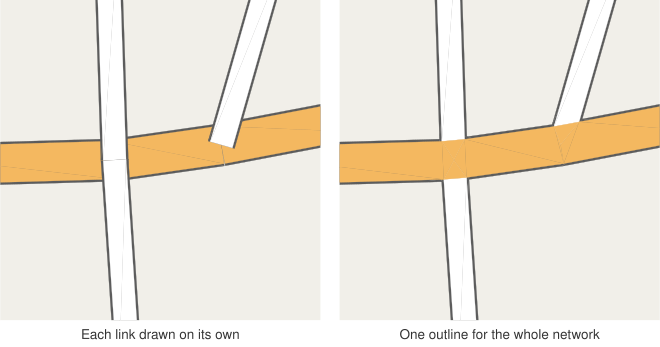
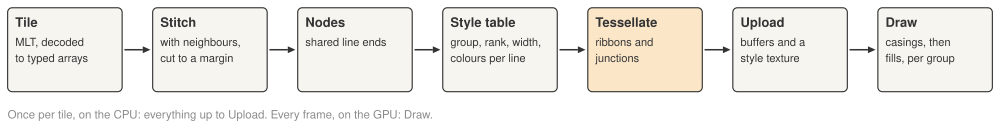

# 1. Drawing roads, not lines

A road dataset is, at heart, a set of centrelines: polylines running down the middle of each road,
split into links wherever the road meets another or one of its attributes changes. Drawing those
polylines as lines is easy. Drawing them as _roads_ is not.

Look at any good street map. A road is a band of colour with a darker outline, as wide as its
class says it should be. Where two roads meet, the bands flow into each other and the outline goes
round the outside of the junction, not through the middle of it. Where a main road crosses a side
street, the main road runs on unbroken and the side street stops at its edge. Curves are smooth,
the outside of a bend is round, and a road that narrows does so gracefully.

None of that comes from the data. The data says only "here is a polyline, it has these
properties". This library is the part in between: a [MapLibre](https://maplibre.org/) custom layer
that reads 3D road centrelines from [MapLibre Tiles (MLT)](https://github.com/maplibre/maplibre-tile-spec)
and draws them with [Three.js](https://threejs.org/) as flat ribbons on the ground, styled like a
map's road symbols.

On the left, every link is drawn as its own outlined ribbon. Outlines cross every junction, and
there is a notch where the main road bends between two links. On the right is what this library
draws from exactly the same data.

## What we want

- **Widths in metres.** A road is as wide on the ground as its style says, at every zoom, and in
  3D, where the camera is tilted, it narrows into the distance like the ground does.
- **One outline per network.** Roads that meet share one outline, drawn round the outside of the
  network.
- **Clean junctions.** Roads meet along straight edges. The more important road runs through a
  junction; the others stop at its edges.
- **True elevation.** The centrelines are 3D, so bridges pass over roads and roads climb hills.
- **Cheap restyling.** Changing widths or colours should not mean decoding or stitching tiles
  again.
- **Tiles that do not show.** Data arrives in tiles, but a junction cut by a tile boundary should
  look exactly like any other.

## The pipeline

Everything heavy happens once per tile, on the CPU:

1. **Decode.** Each MLT tile is decoded into typed arrays: vertex coordinates (x and y on the
   tile's integer grid, z in metres), where each line starts, and each line's properties.
2. **Stitch.** A line near a tile's edge may continue in the next tile. Before a tile is built, its
   lines are joined to those of its neighbours and cut to a margin around the tile, so every
   junction the tile can show is complete. ([Post 6](06-tiles.md).)
3. **Find the nodes.** Line ends with identical coordinates are the same node. Nodes are where
   junctions happen. ([Post 3](03-modelling-roads.md).)
4. **Evaluate the style.** The user's style functions run once per line and fill a compact table:
   draw group, rank, half widths, colours.
5. **Tessellate.** Each line becomes a ribbon of triangles, and each node a junction whose shape is
   worked out from the roads meeting there. This is where most of the design lives.
   ([Posts 3](03-modelling-roads.md) and [5](05-junctions.md).)
6. **Upload.** The triangles go to the GPU as one set of buffers per tile, and the style table as a
   small floating-point texture.

Every frame, the GPU then draws each tile in a handful of draw calls: for each draw group, every
outline first, then every fill. ([Posts 2](02-threejs-in-maplibre.md) and
[4](04-one-outline.md).)

## Four ideas

The rest of the series unpacks four ideas. Here they are in a sentence each.

**Geometry once, width on the GPU.** A vertex does not store where it is; it stores a centreline
point and an offset expressed as "this vector times that line's half width". The shader looks the
widths up from a small texture, so the same triangles draw both the wide outline and the narrower
fill.

**Two passes per level.** Drawing every outline before every fill is what merges the outlines of
connected roads into one. A small twist on the depth test lets a bridge keep its own outline over
the road below.

**Junctions from topology.** Because links that meet share an exact end point, each junction can be
built deliberately: where each pair of neighbouring edges meets, which road runs through, and how
far its colour may reach.

**Tiles that agree.** Each tile is built from its neighbours' data too, so two tiles computing the
same junction compute it identically, and the seam between them disappears.

## What the library is not

It draws opaque, flat ribbons. There is no translucency (overlapping triangles would show), no
banking (offsets lie in the ground plane), and no minimum width in pixels, so a narrow road gets
thin when you zoom out, as it does on the ground. Building tiles runs on the main thread. These
are deliberate limits rather than oversights, and each could be lifted.
