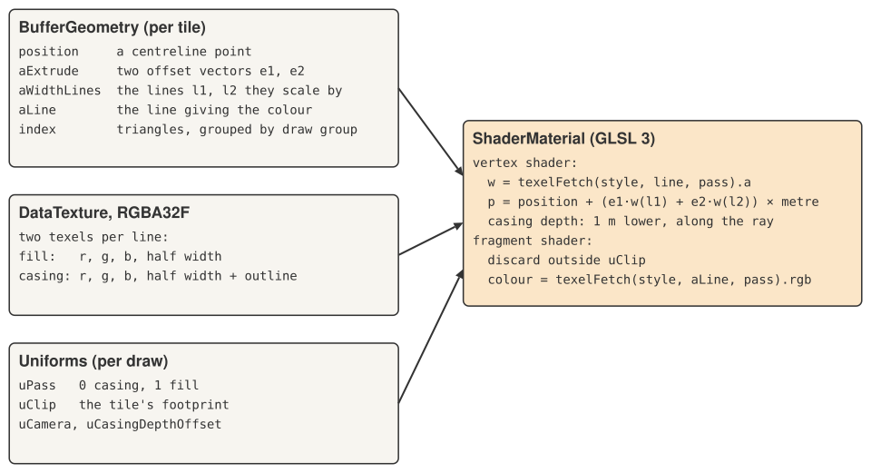

# 2. Three.js inside MapLibre

MapLibre GL JS lets you add your own WebGL drawing to a map through a _custom layer_. This post
walks through how the road layer uses that hook to run Three.js on MapLibre's own WebGL context,
and which parts of Three.js it leans on. If you have used Three.js before but not inside a map, the
interesting parts are the camera (there isn't really one) and the way a single material serves two
render passes.

## The custom layer

A custom layer is an object with an `id`, `type: "custom"`, and a few callbacks. `RoadLayer`
implements three of them:

- `onAdd(map, gl)` runs once, when the layer is added. MapLibre hands over its canvas and WebGL
  context.
- `render(gl, options)` runs every frame, at the layer's place in the style's draw order.
  `options.defaultProjectionData.mainMatrix` is the matrix MapLibre uses for this frame: it takes a
  point in Web Mercator coordinates (`0..1` across the world) to clip space.
- `onRemove()` frees everything.

It also sets `renderingMode: "3d"`. That tells MapLibre the layer has real depth: it gets the
map's depth buffer, which it needs both to hide roads behind each other and for the outline trick
in [post 4](04-one-outline.md).

## One renderer, borrowed

```ts
this.renderer = new THREE.WebGLRenderer({ canvas: map.getCanvas(), context: gl });
this.renderer.autoClear = false;
this.renderer.outputColorSpace = THREE.LinearSRGBColorSpace;
THREE.ColorManagement.enabled = false;
```

`WebGLRenderer` accepts an existing context, so Three.js draws straight into the map's canvas.
Two settings make it a good guest:

- `autoClear = false`, because MapLibre has already drawn the rest of the map and clearing would
  wipe it.
- `renderer.resetState()` at the start of every `render`. MapLibre and Three.js both cache GL state
  (bound buffers, blend modes, depth settings). Each assumes it is the only one touching the
  context, so before drawing, Three.js is told to forget what it thinks it knows.

Colour management is switched off and the output colour space is linear, so a road styled
`#f4b860` comes out as exactly `#f4b860`, matching the rest of the map.

## A camera that does nothing

Three.js normally composes a camera's projection and view matrices with each object's world
matrix. MapLibre already has a complete matrix for the frame, so the layer short-circuits all of
that:

```ts
camera.projectionMatrix.identity();                  // a plain THREE.Camera, never moved
mesh.matrixWorld.copy(main × translate(tileOrigin)); // per tile, every frame
mesh.matrixAutoUpdate = false;
mesh.matrixWorldAutoUpdate = false;
mesh.frustumCulled = false;
```

Each mesh carries the whole model-view-projection matrix in `matrixWorld`. In the shader,
`projectionMatrix * modelViewMatrix` is then that matrix, because the camera contributes nothing.
Frustum culling is off because Three.js would test bounding spheres against a camera that is not
the real one; MapLibre has already chosen which tiles are visible.

The translation to the tile's corner matters more than it looks. Vertex positions are stored
relative to their tile's north-west corner, in Mercator units. At high zoom a tile spans about
`10⁻⁵` of the world. Positions relative to the corner keep their full 32-bit float precision, while
absolute world coordinates near `0.9` would lose it to rounding, millimetres turning into
centimetres and roads shimmering as you pan. The large part of the position, the tile's origin,
lives in the 64-bit matrix built on the CPU. Each world copy across the antimeridian gets its own
matrix too: MapLibre reports which copy a covering tile belongs to, and the layer adds that wrap to
the origin.

## Buffers: `BufferGeometry` with custom attributes



A tile's triangles are uploaded as one `BufferGeometry` with four vertex attributes:

| attribute     | type    | meaning                                                                    |
| ------------- | ------- | -------------------------------------------------------------------------- |
| `position`    | `vec3`  | a point on a centreline, relative to the tile's corner; z is the elevation |
| `aExtrude`    | `vec4`  | two offset vectors, `e1` and `e2`, in units of half widths                 |
| `aWidthLines` | `uvec2` | the two lines whose half widths scale `e1` and `e2`                        |
| `aLine`       | `uint`  | the line whose colour the vertex takes                                     |

[Post 3](03-modelling-roads.md) explains why an offset is two vectors and two line numbers. For now
it is enough that a vertex's final position is `position + e1 × w(l1) + e2 × w(l2)`, where `w`
is a half width looked up per line.

The line numbers are integers and must reach the shader exactly. They are stored in `Uint32Array`
`BufferAttribute`s, which Three.js binds with `vertexAttribIPointer`, so the shader reads them as
`uint` and `uvec2`, not as floats.

Triangles are sorted by draw group (bridges above ground level, for example) and each group is a
contiguous range of the index buffer. Rather than splitting the data, the layer creates one
`BufferGeometry` per group that shares the same attributes and index, and sets
`geometry.setDrawRange(start, count)` on each. The buffers are uploaded once; each geometry just
draws its slice.

## Style: a `DataTexture` the shader indexes

Widths and colours live in a texture rather than in the vertices:

```ts
const texture = new DataTexture(texels, 1024, rows, RGBAFormat, FloatType);
texture.minFilter = texture.magFilter = NearestFilter;
texture.generateMipmaps = false;
```

Each line owns two texels: the fill's colour and half width, and the casing's colour and outer half
width (half width plus outline). The shader fetches them with `texelFetch`, which reads one texel
by integer coordinates with no filtering, so the values come back exactly as written.

Keeping widths out of the vertices is what lets one set of triangles serve both the casing and the
fill. Restyling still rebuilds each tile's triangles, because the shape of a junction depends on
widths and ranks ([post 5](05-junctions.md)), but it starts from the stitched lines each tile kept:
nothing is decoded or stitched again.

## One material, two passes

Every road is drawn twice: once as its casing (the outline), once as its fill. Both passes use the
same geometry and the same `ShaderMaterial`; only a uniform tells the shader which texel to read.

```ts
new ShaderMaterial({
  glslVersion: GLSL3,
  vertexShader, fragmentShader,
  side: DoubleSide,
  depthTest: true,
  uniforms: { uPass, uClip, uCamera, uOrigin, uScale, uMetre, uLineStyle, uCasingDepthOffset, ... },
});
```

- `glslVersion: GLSL3` gives the shaders `texelFetch`, integer attributes and `flat` varyings.
- `DoubleSide`, so that triangle winding never matters: a flat ribbon has no back face worth
  culling.

Each tile gets two meshes per draw group, one per pass. Three.js draws opaque objects sorted by
`renderOrder` first, so the layer sets `renderOrder = group × 2 + pass`: group 0's casings, group
0's fills, group 1's casings, and so on. The per-draw state goes in `onBeforeRender`, which
Three.js calls just before each mesh is drawn:

```ts
mesh.onBeforeRender = (renderer, scene, camera, geometry, material) => {
  material.uniforms.uPass.value = pass;
  material.uniforms.uCamera.value.copy(eye); // the camera in this tile's coordinates
  material.uniforms.uClip.value.set(x0, y0, x1, y1);
  material.depthWrite = pass === 0; // casings write depth, fills only test it
  material.uniformsNeedUpdate = true;
};
```

Setting `uniformsNeedUpdate` makes Three.js upload the changed uniforms even though the material
object is shared between the two meshes. Toggling `depthWrite` per pass is the heart of the outline
technique, which [post 4](04-one-outline.md) covers.

So a frame costs `tiles × groups × 2` draw calls, whatever the number of roads.

## Shaders

The vertex shader does three things:

1. Look up both half widths for this pass and apply the offset: `local = position.xy + (e1 ×
w(l1) + e2 × w(l2)) × metre`. Widths are metres, but positions are Mercator units, and a metre
   in Mercator units grows towards the poles: `metre = uMetre × cosh(π(1 − 2y))` at the vertex's
   latitude.
2. Project with the tile's matrix.
3. In the casing pass, replace the depth with that of a point a little lower, along the vertex's own
   view ray ([post 4](04-one-outline.md)).

The fragment shader is almost trivial: it discards fragments outside the tile's own footprint
(`uClip`), and outputs the line's colour. The colour comes through a `flat` varying, so a triangle
takes one line's colour rather than a blend of three.

The clip test is what lets tiles overlap safely. Tiles are built with a margin of neighbouring
data, so their triangles spill past their edges; each tile draws only inside its own square, and
every pixel is drawn by exactly one tile.

## Choosing tiles

Each frame, `map.coveringTiles({ tileSize, minzoom, maxzoom })` returns the tiles MapLibre would
use for a source with those settings.

There is a catch with 3D data. MapLibre decides whether a tile is in view by testing a box against
the camera's frustum, and without terrain that box is flat at sea level. Roads in hilly country can
lie hundreds of metres higher. Seen from a tilted camera, a road 500 m up near the bottom of the
screen is inside a tile whose sea-level footprint is out of view, so the tile would never be
loaded. The layer therefore gives every box the elevation range of all the roads it has seen so
far. It does so through the hook MapLibre's own terrain uses for the same purpose, an object with
a `getMinMaxElevation` method passed as the `terrain` option. MapLibre's public types leave that
option out, so this is the one place the layer leans on an internal detail.

For each covering tile, the layer draws it if it is built. If not, it
draws its nearest built ancestor, clipped to the child's footprint, so a coarser version of the
roads fills the gap until the detailed one is ready. At most one tile is built per frame, which
keeps the cost of panning into new data spread over several frames. Tiles are kept in a
least-recently-used cache, and evicted tiles have their geometry, texture and material `dispose()`d.

## Picking

Clicking on a road should find that road, at any pitch and at its true elevation. Three.js's
`Raycaster` would need a real camera and real world-space geometry, neither of which the layer has.
Instead, `RoadLayer.pick(x, y)` inverts each drawn tile's matrix to turn the click into a ray in the
tile's coordinates, and intersects it with each segment's ribbon, treated as flat at the segment's
elevation. Of the hits, the nearest to the camera wins, which is the one the depth test drew on
top.
