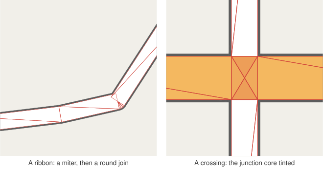
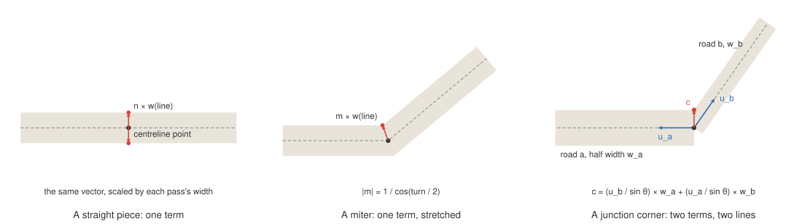

# 3. Modelling a road

Before anything can be drawn, the layer needs a model of what a road _is_. This post describes the
three things it works with: lines, nodes and a style table. It then describes the ribbon, the
triangles a line becomes, and the one trick everything else in the series depends on: offsets
expressed as terms.

## Lines

The input is a layer of 3D line strings. Each feature is a _line_: a polyline of vertices, with x
and y on the tile's integer grid and z in metres above a datum. Lines are usually _links_ in the
transport-network sense: a road is split into a new link at every junction, and often wherever one
of its attributes changes, such as its width class, a bridge starting, or a median strip beginning.
A single street may therefore be a dozen lines, and the renderer cannot assume that a line ends
only where something interesting happens.

Each line keeps its feature's properties as a plain object. The renderer itself never reads them;
only the user's style does.

## Nodes

Where lines meet, they share an end point exactly: the same x, y and z. The layer groups line ends
by their coordinates into _nodes_. A node with one end is a free end of the network (a dead end, or
the edge of the data). A node with two ends is just a road continuing from one link into the next.
A node with three or more ends is a junction.

This is the _topology_ of the network, and it comes straight from the data. Nothing is snapped or
guessed: two lines that pass over each other on a bridge do not share a vertex, so they do not form
a node, and they are drawn one over the other. Two lines that are meant to meet do share one.

There is one exception, covered in [post 6](06-tiles.md): an end where a line was cut by a tile
boundary is not a real end, and joins no node.

## The style table

The user describes the look of roads with a `RoadStyle`: a handful of functions from a feature's
properties to values.

```ts
style: {
  group: (p) => (p.bridge ? 1 : 0),               // draw level
  rank: (p) => ({ primary: 2, secondary: 1 })[p.class] ?? 0,
  width: (p) => Number(p.width) || 4,             // full width, metres
  color: (p) => (p.class === "primary" ? "#f4b860" : "#ffffff"),
  outline: { width: () => 0.6, color: () => "#5c5c5c" }, // metres per side
  cap: "round",
}
```

For each tile, these functions run once per line and fill a _style table_: a set of typed arrays
indexed by line number.

- **Group** is a draw level. Every road of group 0 is drawn before every road of group 1, each
  group with its own outline. It is meant for things like bridges and tunnels that should look
  separate from the network beneath. Roads in different groups do not merge their outlines.
- **Rank** orders roads within a group. Where two roads overlap, the higher rank is drawn on top,
  and at a junction rank decides who runs through ([post 5](05-junctions.md)).
- **Half width** and **outer half width** are half the road's width, and that plus the outline:
  the widths of the fill and of the casing.
- **Fill** and **casing** colours.

All widths are in metres on the ground. A road styled 8 m wide is 8 m wide at every zoom level.

## Ribbons

Each line becomes a _ribbon_: a strip of triangles of the road's width, centred on the line.



Along a straight segment, the ribbon is a quad, two triangles, whose corners sit at the
centreline's vertices offset sideways by the half width. Where the line bends by a little (up to
15°), the two segments meet at a _miter_: a single corner on each side, on the bisector of the
bend. Where it bends more, a miter would poke out too far, so the outside of the bend gets a _round
join_, a fan of triangles at most 15° apart, while the inside still meets at a single corner.
The free ends of the network get the style's cap: butt, square or round.

Nodes with three or more ends are junctions, and they are worth a post of their own
([post 5](05-junctions.md)). Nodes with two ends are treated by exactly the same machinery as a
junction of two: usually that produces a plain miter or round join, as if the two links were one
line, but it also handles two links of different widths meeting ([post 5](05-junctions.md)).

## Offsets as terms

Here is the central trick. A vertex of a ribbon does not store its final position. It stores a
point on the centreline, and an offset from it written as up to two _terms_:

```
offset = e1 × w(l1) + e2 × w(l2)
```

Each term is a vector (`e1`, `e2`) times the half width of a named line (`l1`, `l2`). The GPU
looks up `w` for the current pass, the fill's half width or the casing's outer half width, and adds
up the terms.



- On a straight piece, the offset is the side normal `n` times the line's own half width: one term.
- At a miter, it is the bisector `m`, stretched by `1 / cos(turn / 2)` so that the corner lands
  exactly on both edges: still one term.
- On a round join or a cap, each fan vertex is a unit vector round the arc times the line's half
  width.
- At a junction corner, where road `a`'s edge meets road `b`'s edge, it is two terms naming two
  different lines.

That last case is why there are two terms. With `u_a` and `u_b` the directions of the two roads
leaving the node and `θ` the angle between them, their edges meet at

```
c = (w_a × u_b + w_b × u_a) / sin θ
```

The corner is a sum of `w_a` times one fixed vector and `w_b` times another. It is _linear_ in the
two widths. So it can be written as two terms, `u_b / sin θ` times `w(a)` plus `u_a / sin θ` times
`w(b)`, and the GPU will put it on the exact corner for whatever widths the pass uses.

This buys three things at once.

**Both passes are exact.** The casing pass evaluates the terms with outer half widths and gets the
exact corner of the wide outlines; the fill pass evaluates them with fill half widths and gets the
exact corner of the fills. One geometry, two correct shapes.

**No cracks.** Two triangles that share a corner store identical terms for it, from the same
computation, so the GPU computes bit-identical positions for them. There is no tolerance anywhere
that a gap could slip through.

**Widths stay out of the vertex buffer.** Only directions are stored. The widths arrive through the
style texture ([post 2](02-threejs-in-maplibre.md)).

## Metres, Mercator and elevation

The map works in Web Mercator coordinates, where a metre on the ground is longer the farther you
are from the equator. A tile is small, but at high latitudes the scale changes noticeably even
across one, so the vertex shader converts metres to Mercator units at each vertex's own latitude:

```
metre(y) = metre at the equator × cosh(π (1 − 2y))
```

which is `1 / cos(latitude)` written in terms of the Mercator `y`.

The z coordinate of each vertex is converted the same way, so a bridge 10 m above the ground is 10
m above it in the map's 3D space. Widths, however, are applied flat, in the ground plane: a ribbon
on a slope is a little narrower, measured along the slope, than its style says. On real roads the
difference is negligible.
