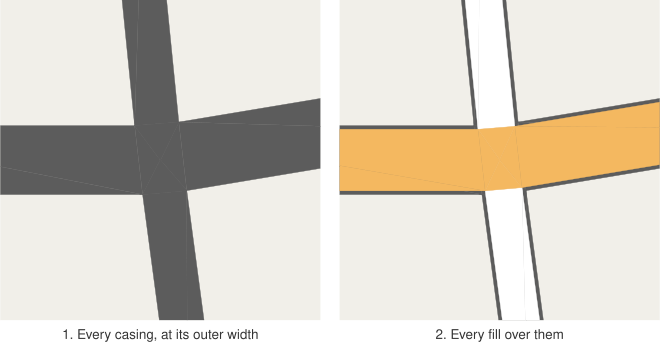
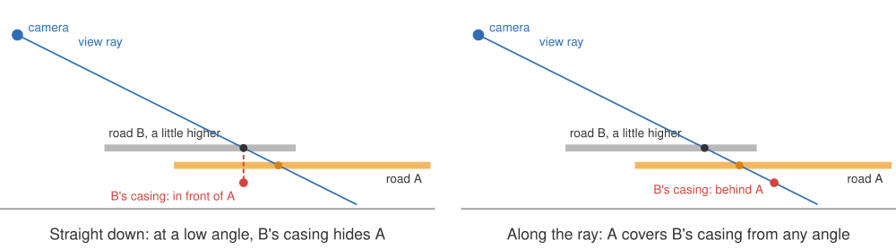

# 4. One outline for a network

A road symbol on a map is two shapes: a _casing_, the dark outline, and a _fill_, the coloured band
on top of it, a little narrower. Draw each road's casing and then its fill, one road after another,
and every road gets its own outline, including across every junction it shares with another road
(the left half of the first figure in [post 1](01-drawing-roads.md)). This post is about drawing
one outline for a whole network instead, and about the depth test that makes it work in 3D.

## Every casing first, then every fill

The fix is old and simple: draw the casings of _all_ roads first, then the fills of all roads on
top.



Where two roads meet, each fill covers the other road's casing as well as its own, so the outline
survives only round the outside of the network. That is why every tile is drawn in two passes
([post 2](02-threejs-in-maplibre.md)). The same triangles serve both passes: the casing pass uses
each road's outer half width, the fill pass its fill half width ([post 3](03-modelling-roads.md)).

Within a pass, the triangles are drawn in a fixed order, sorted by rank, so where the fills of two
roads overlap, the higher rank wins. Ranks also get a refinement for roads that merge: see the end
of this post.

## Draw groups: separate networks

Merging all outlines is wrong where roads really are separate: a bridge passing over a road should
keep its outline over it. Draw _groups_ handle the levels that the style knows about. Groups are
drawn in ascending order, each with both of its passes, so a bridge in group 1 draws its casing
over the fills of group 0 and keeps its own outline.

Groups are a blunt tool, though. They need the style to know which roads are elevated, and they
separate whole classes of roads, not individual crossings. The depth buffer can do better, because
the centrelines are 3D.

## Depth: outlines that know about height

The two passes treat depth differently:

- **Casings write depth.** In the casing pass, every road writes its depth into the depth buffer.
- **Fills only test depth.** In the fill pass, a fill is drawn wherever it is not behind something
  already in the depth buffer, but it does not write depth itself.

If casings wrote their true depth, a fill would fail the depth test against the casing of any road
a few centimetres above it, and roads meeting on a slope would show seams. So the casing writes the
depth of a point a little _lower_ than the road: one metre by default (`casingDepthOffset`).

Now consider a pixel where two roads overlap:

- If they are within a metre of each other in height (they meet, or they are the same road), the
  fill of one is in front of the other's lowered casing, so it covers it. The outlines merge.
- If one passes several metres over the other, as a flyover does, the upper road's casing is still
  above the lower road's fill even after lowering, so it hides it. The upper road keeps its outline
  and its fill, and the lower road disappears beneath it.

This works for any pair of roads, in any group, without the style saying which roads are bridges.
And since the casings go into MapLibre's own depth buffer, roads are also hidden correctly behind
other 3D layers.

## The angle problem

The first version of this lowered the casing the obvious way: take the vertex, move it straight
down by one metre, and use the depth of that point. It looked right from above. Tilted towards the
horizon, it went wrong: a road merging into another at a shallow angle, a few tens of centimetres
above it, cut a jagged notch out of the other road's fill. The steeper the camera's pitch, the
bigger the notch.



The depth buffer measures distance along the camera's line of sight, not height. Moving a point one
metre straight down moves it only `cos(pitch)` metres along the line of sight. Meanwhile, two
surfaces `h` apart in height are about `h / cos(pitch)` apart along a view ray that is about as
steep as the camera. So the lowered casing of a road `h` above another stays in front of the other
road's fill once

```
cos²(pitch) < h / offset
```

With a 1 m offset and roads 0.2 m apart, that is a pitch of about 63°, well within what MapLibre
allows.

The fix is to lower the casing _along the ray through its own pixel_. For a vertex at `q` and a
camera at `eye`, the point on that ray one metre lower is

```
q + (q − eye) × offset / (eye.z − q.z)
```

The vertex stays where it is on screen; only its depth changes, to the depth of that point. A fill
then covers a casing exactly when, at that pixel, the fill lies less than one metre below the
casing's road, whatever the angle.

The camera's position is not something MapLibre hands over, but it can be recovered from the
frame's matrix: the eye is the one point the projection sends to clip-space `x = y = w = 0`. The
layer solves for it once per tile per frame, in the tile's own coordinates, and passes it to the
shader as a uniform. In the rare case where a vertex is at or above the camera, its ray never
descends, there is no lower point on it, and the casing goes to the far plane, behind every fill.

## Roads that merge

Rank decides which fill is on top where roads overlap. That is usually what you want, but not where
a road merges into another at a shallow angle, a slip road joining a main road, say. For several
metres the two ribbons overlap. If the slip road had the higher rank, its fill would be drawn over
the main road all along the overlap, and the main road would look as if it had been cut.

So ranks are adjusted per tile into _draw levels_: a road that ends at a junction owned by another
road ([post 5](05-junctions.md)) is lowered beneath it, along with the links it continues into
through nodes of two. A merging road then shows only beyond the main road's edge. Roads that
overlap without meeting still follow their ranks.

## Limits

A junction's core is drawn once, in its owner's group. Where roads of different groups meet at a
node, say a ground-level road continuing onto a bridge drawn in a higher group, the lower group's
casing can show along the edge of the core. If bridges are styled into the same group as the
roads they connect to, which the depth test makes possible, the seam does not arise.
