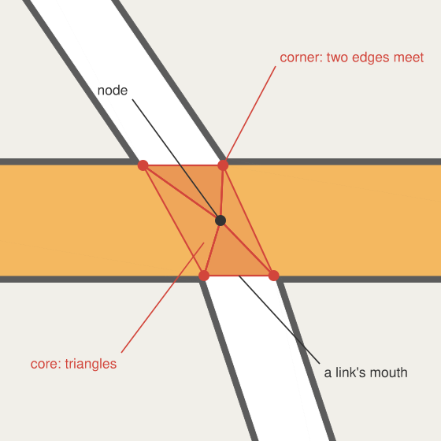
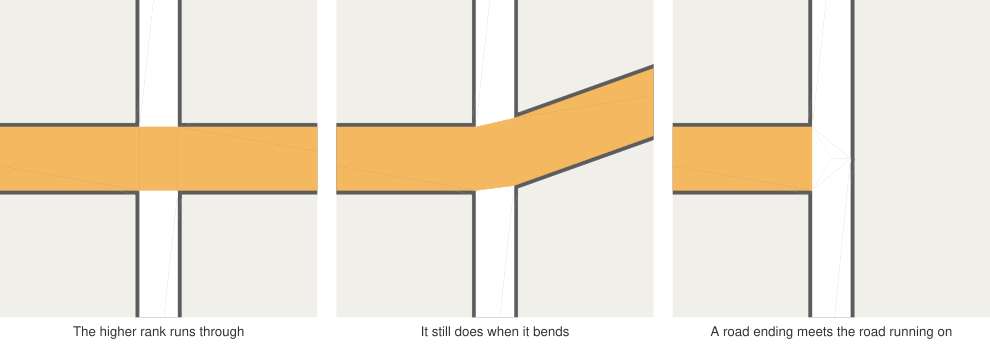
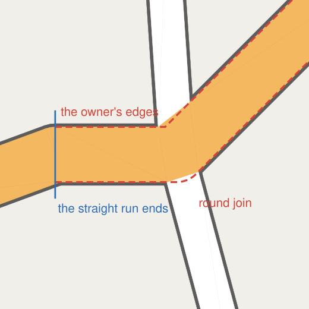
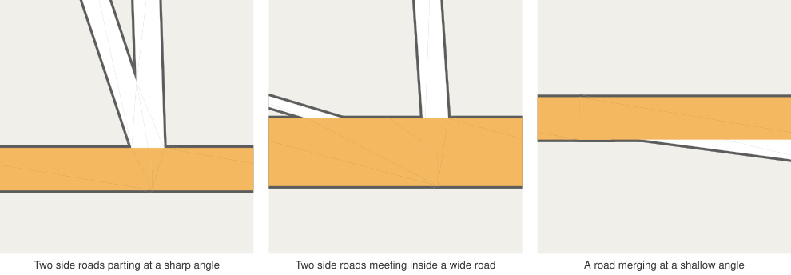
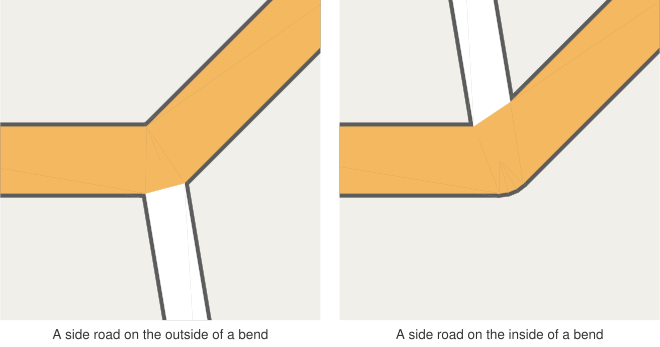
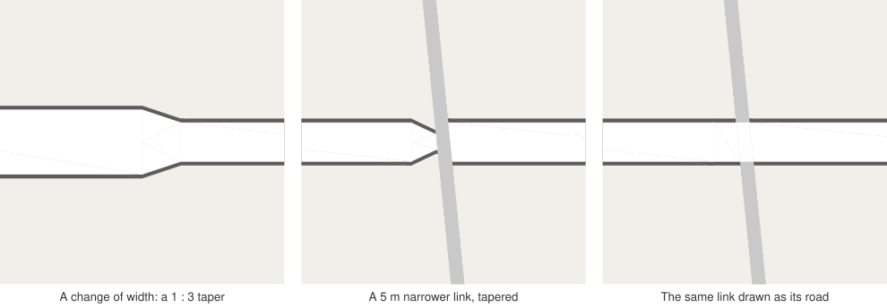

# 5. Junctions

Ribbons are the easy part. Junctions are where a road renderer earns its keep, and where most of
this library's code lives. This post builds a junction up from its geometry, then works through
the questions that geometry alone cannot answer: whose colour fills the junction, how far that
colour may reach, and what to do when the data does something awkward.

## Anatomy of a junction

At a node with three or more line ends, take the links leaving the node and sort them by angle. Each
pair of neighbours, going round, has a _gap_ between them. In each gap, the left edge of one link
meets the right edge of the next at a _corner_.

Each link stops at its two corners. The short edge between them is the link's _mouth_. What is left
in the middle is a polygon whose sides are the mouths, and it is filled by the _core_: a fan of
triangles from the node out to the corners.

Each corner comes from the formula in [post 3](03-modelling-roads.md), so it is exact in both the
casing and the fill pass. Each corner is shared by the two links that meet there and by the core,
and all three encode it identically, so the GPU puts every copy on the same point.

The basic construction needs a few safeguards:

- **Wide gaps.** Across a gap of more than a right angle, two edges can meet very far out. A corner
  farther from the node than four times the wider half width is not used; the links stop square at
  the node instead.
- **Reflex gaps.** Across a gap of more than 180°, the two edges diverge and never meet. That is
  the outside of a bend, and a round fan bridges it, its radius going smoothly from one road's
  half width to the other's.
- **Short links.** A corner may lie farther along a link than the link's first segment. A link may
  stop as far along as its first segment allows: nearly all of it if the link bends at its next
  vertex, and a share of its length if it is a short link with another junction at its far end. A
  link whose corner lies beyond that stops on its own edge, and a small triangle, a _notch_,
  bridges it to its neighbour's corner. Neither link sticks out, and the edge it meets stays
  straight.

## Who owns the junction?

The core needs a colour. The obvious choice, the colour of the highest-ranked link, is wrong more
often than it looks. Think of a residential street crossing another at a crossroads, with one of the
four links a slightly wider class: you do not want the wider link's colour to punch a square into
the street that runs straight through.

So the layer looks for a road that _runs through_ the junction: two ends drawn alike (same group,
rank, widths and colour) whose edges, on both sides, carry the mouths of the links between them. A
little slack, half the road's half width, allows a slight bend at the node. If such a road exists,
it _owns_ the junction: the core is filled in its colour, its edges run straight on across the
junction, and the other links stop at them, whatever their rank or width. If several roads run
through, as at a crossroads, the highest-ranked one owns it. If none does, the top-ranked link owns
it.

A link that owns a junction with its one end, as where a road splits into two carriageways, ends
there. It draws its own mouth and nothing behind it, and the links leaving fill the rest of the
junction in their own colours. Without that rule the owner would paint a half disc of its colour
over the start of the carriageways. The exception is a link of its colour leaving straight on, as a
motorway runs on into its ramp: the owner then runs on into that link as if the two were one road,
whatever their ranks, and side roads leaving between them stop at their edges.

There is one more rule, and it comes from bitter experience ([post 6](06-tiles.md) has the full
story). Whether a road counts as running through depends on how sharply it bends at the node, and
that is fragile: rounding the coordinates to a coarser tile grid can push a bend of 14° past 15° and
flip the owner between zoom levels. So **rank comes before running straight**. A pair of ends drawn
alike that turns by no more than a right angle owns the junction over any lower-ranked road that
runs through it, and of several such pairs, the straightest wins. The middle panel above shows a
main road bending 20° through a crossing with a straight side road: it still owns the junction.
The right-angle limit keeps two slip roads leaving side by side from counting as one road.

## How far the owner's colour reaches

Owning a junction does not mean filling all of it. Where two side roads leave the main road close
together, their corner can lie well beyond the main road's edge. Filling the whole polygon in the
owner's colour would paint a wedge of main road out between the two side roads. Instead, the owner
draws only what belongs to it:

- The mouths of its own ends, and the gaps between them.
- On each side of it where other links leave, the junction's polygon, but no farther than its own
  _outline_.

The outline is where the owner's edges would be if the other roads were not there:

- **Ahead of each end, its edge**, as far as the road runs straight from the node. That is not
  just the first segment: the edge follows the line on through its vertices, and through nodes of
  two into links drawn alike, as long as the road turns by less than 15°. Data often splits a road
  a few metres past a junction for an attribute that does not change its drawing, and the first
  segment alone would cut the outline short there.
- **Where both ends lie ahead**, the farther of the two edges, since the road is both links there.
- **Round the outside of a bend**, a round join, matching the ribbon.

Then:

- **A corner beyond the outline** is pulled in onto it.
- **A corner beyond where both of its links stop running straight** is no boundary at all: both
  roads bend away before reaching it. Beside such a corner, the outline itself bounds the owner.
- **A corner where two other roads meet each other**, inside the owner's band and against one of
  its straight edges, is pushed out onto that edge. Two side roads meeting at the middle of a wide
  road would otherwise notch its edge.
- **A corner between the owner and a side road beyond where the owner runs straight** is dropped,
  and both stop square at the node. A roundabout is the typical case: a wide road enters a narrow
  ring whose segments are under a metre long, and the edges meet several metres out along the
  ring's tangent, where the ring has already curved away. The ring cannot reach that corner, and a
  notch bridging to it would stick out past its curve. Stopped square, the entering road runs at full
  width to the node, beneath the ring, whose band covers its end; the joint follows the ring's real
  curve.

Everything else belongs to the other links: each draws its own mouth, its notch and the gaps
between it and its neighbours, in its own colour, beneath the owner.

On the left, two side roads part at a sharp angle; the main road's edge runs straight past them,
and the area between them is theirs. In the middle, two side roads meet each other inside a wide
road, which runs on unbroken. On the right, a road merges at a shallow angle. Its overlap with the
main road is drawn beneath it, thanks to the draw levels from [post 4](04-one-outline.md).

## Bends

When the owner bends at the junction, the side roads on the inside of the bend meet edges that
converge, and those on the outside meet the round join.

The round join is drawn only where the road actually turns, by 15° or more. On a side that is
nearly straight, a change of width, say, the mouths of the roads leaving there bound the owner
instead, so its edge does not zigzag between them.

## Changes of width

Two links of different widths meeting nearly straight at a node of two are one road changing
width. Mitering them would leave a step in the outline. Instead the wider link stops square at the
node, and the narrower link's edge begins three times the difference in half widths further on.
The step becomes a 1 : 3 slanted face that the casing outlines like any other edge.

The taper needs room. Data sometimes gives a road's last few metres before a crossing a narrower
class than the rest of the road. Tapered, that link is all taper. The road would end in a wedge
short of the crossing, and the crossing would look twisted, as in the middle panel. So a link
qualifies as part of the road it continues when:

- it narrows from a road at a node of two, turning by no more than a right angle;
- it is shorter than its taper would need;
- it runs into a junction.

It is then drawn with that road's style, and the road crosses straight, as in the right panel. This
happens before tessellation, in the style table itself, so the widths in the texture and the
widths the geometry was built for always agree.

## Stubs

Some data joins lines a few decimetres apart with a line of its own: where a road splits into two
carriageways, say, each carriageway may start just beside the road's end, joined to it by a
connector under a metre long running across the road. Drawn, such a connector is a ribbon wider
than it is long, and two of them leaving the road's end in opposite directions look like a road
running through the junction, which then owns it and caps the road's end in its colour.

So before the junctions are built, every visible line joined to others at both ends and shorter
than its own half width is taken out as a _stub_. The nodes it joined become one, at the node where
most other lines end, and the lines ending at the others have their end vertex moved onto it, by
less than a road's half width. The junction then sees the road and its carriageways meeting at one
node. Whether a line is a stub depends on its width, so this happens per style, like the short
links above; the tile keeps its original lines for picking.
