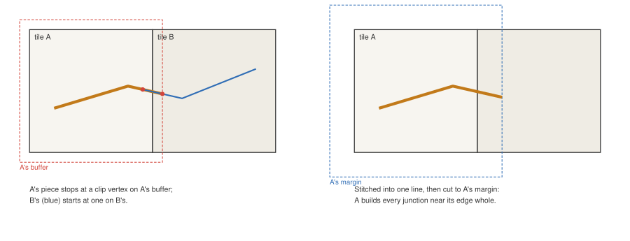
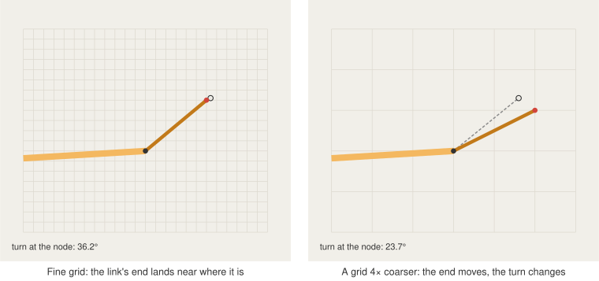

# 6. Tiles without seams

Vector tiles cut the world into squares, and every square is meant to be drawn on its own. Road
junctions do not respect squares. This post is about building each tile so that a junction sitting
on a tile boundary is drawn exactly as if the boundary were not there, and about a subtler effect
of tiling: the same road has slightly different coordinates at each zoom level.

## Buffers are not enough

A tiler clips each tile's lines to a box a little larger than the tile, its _buffer_, so that
lines drawn up to the edge do not end abruptly. A typical buffer is 64 units on a 4096-unit grid:
at a high zoom, a couple of metres.

That is plenty for thin lines, but not for road symbols. A junction's corners can lie several
times a road's half width from its node ([post 5](05-junctions.md)), so a junction just outside a
tile can still reach into it. Built from its own data alone, a tile sees only stubs of the roads
meeting there, clipped at its buffer. It draws them as free-standing ribbons and gets the junction
wrong. Meanwhile, the neighbouring tile builds the junction correctly but draws only inside its own
square, so the two halves do not match.

## Stitching neighbours

So a tile is built from its own lines _and_ its neighbours' lines at the same zoom, joined back
into whole lines, then cut to a margin around the tile.

Where the tiler cut a line, it inserted a _clip vertex_ exactly on the buffer box. That is the clue
for putting lines back together. Two pieces from neighbouring tiles are joined when:

- **they overlap**, sharing a run of vertices. Since all tiles at one zoom share one integer grid,
  the original vertices are bit-identical in both.
- **they leave a gap**, both ending at a clip vertex on the segment between their nearest real
  vertices. This happens when the buffers do not overlap the segment that crosses the boundary.
  Candidates are taken shortest gap first, which resolves the rare case of a line running straight
  through several tiles.
- **one is made of clip vertices only**, a segment crossing a tile with no vertex inside it. Such a
  piece is dropped if a stitched line already covers it, extends a clipped end if one lines up with
  it, or is merged onto its segment.

Pieces join only if their properties are equal, and two different lines that merely meet at a node
are never joined.

The stitched lines are then cut to the tile plus `stitchMargin` (40 m by default, enough for any
junction that can reach the tile). Ends cut there, and ends still clipped because the data really
runs out, are marked _clipped_. A clipped end joins no node and gets no cap: it is not an end of
the road, only of the data the tile was given.

Because every tile computes each nearby junction from the same complete lines, two tiles sharing a
junction compute it identically, and each draws its own half.

A few practical points:

- **Only what is needed is stitched.** The number of neighbours depends on how far the margin
  reaches beyond the tile's own buffer, which shrinks at high zooms where tiles are small. Pieces
  are filtered to the margin box before they are joined, which keeps the extra cost modest: in our
  tests, building a mid-zoom tile took about 1.2–1.5 times as long with stitching as without.
- **Where the buffer already covers the margin**, at low zooms where tiles are large, a tile is
  built alone.
- **Order is deterministic.** Stitched lines are sorted by their properties and first vertex, so
  two tiles break ties in draw order the same way.
- **Failures are loud.** If pieces cannot be aligned consistently, the tile fails with an error
  rather than drawing a guess.

## Waiting for neighbours

A tile cannot be built until its neighbours have loaded. Until then, its nearest built ancestor
stands in, clipped to the child's footprint, so the map never shows a hole, only briefly a coarser
version of the roads.

Every tile, built or standing in, draws only inside its own footprint: the fragment shader discards
everything outside it ([post 2](02-threejs-in-maplibre.md)). The margin's triangles exist only so
that the triangles inside the tile are right.

## The grid moves under you

Tile coordinates are integers. Each zoom level down, a tile covers twice the distance with the
same 4096 units, so each unit covers twice as much ground. Two vertices 4.5 m apart may be about 150 units apart at one zoom and under 40 two zooms lower,
and their positions round differently.

For long segments this does not matter. For a short link, it changes the link's direction by
several degrees. The renderer has thresholds that depend on direction: a road continues through a
junction if it bends only slightly, a miter becomes a round join at 15°. A junction near a
threshold can therefore be drawn one way at one zoom level and another way at the next, which is
exactly what happened with an early ownership rule: a main road turning about 14° through a 4.5 m link
ran through its junction at high zoom, but two zooms lower turned just over 15°, lost the junction
to a straight side road, and was drawn cut in two.

No threshold can be placed where rounding will not cross it. The lesson was rather to make the
decisions that change a picture most depend on things rounding cannot change. Rank does not
depend on coordinates at all, which is why rank now comes before straightness when deciding who
owns a junction ([post 5](05-junctions.md)). The straight-run rule, which follows a road through
its next vertices instead of trusting its first short segment alone, has the same aim.

Elevation does not suffer from this. z is stored on its own fixed grid in metres, the same at
every zoom level, so heights, and the depth test that depends on them, are as precise at zoom 10 as
at zoom 18.
